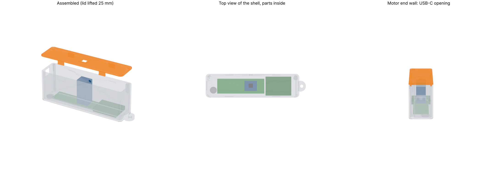

# Trek Buddy

Off-grid location sharing and SOS pendants for trekking groups, for places with no mobile network.

Each trekker wears a small pendant. The pendants share their GPS positions with each other over LoRa radio, and every pendant relays what it hears, so the group forms a small mesh. Holding the button for 3 s sends an SOS, and every other pendant vibrates. A phone paired with a pendant over Bluetooth shows a compass radar with the distance and direction to everyone in the group, and it works fully offline.

**Phone app:** https://sanchita-suni.github.io/trek-buddy/radar/ (Android, Chrome)

<p align="center"></p>

## What's in this repo

| Path | What it is |
|------|------------|
| [`pendant/pendant.ino`](pendant/pendant.ino) | Pendant firmware for the XIAO nRF52840 with a Wio-SX1262 LoRa radio |
| [`radar/`](radar/) | **Trek Buddy Radar**, the offline phone app (PWA, Web Bluetooth). See [`radar/README.md`](radar/README.md) |
| [`prints/v2.1/`](prints/v2.1/trek_pendant_v2/) | Current enclosure: STL files, STEP file and the parametric CadQuery source (`trek_case_v2.py`) |
| [`prints/v2/`](prints/v2/trek_pendant_v2/) | Previous v2 enclosure (kept for reference) |
| [`prints/*.stl`](prints/) | First (v1) enclosure |
| [`Trek_Buddies_Build_Manual.docx`](Trek_Buddies_Build_Manual.docx) | Full build manual: parts list, wiring, assembly, testing, safety |

## How it works

```
 Trekker A pendant  ── LoRa 865 MHz ──  Trekker B pendant  ── LoRa ──  Trekker C pendant
        │                (relays up to 3 hops)
        │ Bluetooth LE
        ▼
 Phone: Trek Buddy Radar (offline)
```

- **LoRa (865–867 MHz, India's licence-free band):** each pendant broadcasts its position every 30 s. Settings are SF9, 125 kHz bandwidth, 20 dBm.
- **Mesh:** every pendant re-broadcasts packets it hasn't seen before, up to 3 hops, with a short random delay to reduce collisions.
- **SOS:** a 3 s button hold, or a hold on the phone app's SOS button, sends an SOS every 5 s until another pendant acknowledges it. The SOS flag then stays on that pendant's packets until it's cancelled with another 3 s hold. Other pendants vibrate every 8 s until the SOS ends. A short press silences the alert.
- **Bluetooth:** the pendant forwards every packet it sends or receives to the paired phone, and the phone can start or cancel SOS. The protocol is documented in [`radar/README.md`](radar/README.md#bluetooth-protocol-from-the-pendant-firmware).

Typical LoRa range is 1–3 km on open trail and 5 km or more with line of sight. Dense forest, gorges and ridges cut it a lot, and the relaying helps fill those gaps.

## Hardware (per pendant)

- Seeed XIAO nRF52840, with the Wio-SX1262 for XIAO LoRa radio (868 MHz variant, which is tuned for the 865–867 MHz band)
- GPS module on `Serial1` at 9600 baud
- 868 MHz antenna (U.FL)
- 3.7 V LiPo battery (500–800 mAh), charged by the XIAO's built-in charger
- Push button on `D0` (to GND, using the internal pull-up)
- 10 mm coin vibration motor, driven through an NPN transistor (with flyback diode) from the NFC1 pad (`P0.09`). The firmware converts the NFC pads to normal GPIO on first boot.
- 3D-printed case (see `prints/`)

The full parts list with prices, the circuit diagram and assembly steps are in the build manual.

## Flashing the firmware

1. Install **Arduino IDE 2**. Add the Seeed boards URL
   `https://files.seeedstudio.com/arduino/package_seeeduino_boards_index.json`
   and install **Seeed nRF52 Boards** (the non-mbed one).
2. Install the libraries **RadioLib 7.8.1** (not 8.x) and **TinyGPSPlus**.
3. Open `pendant/pendant.ino` and set a **different `NODE_ID`** for each pendant (1, 2, 3, …). Every pendant in a group must use the same `GROUP_ID`.
4. Select the board **Seeed XIAO nRF52840** and upload. If the board doesn't appear, double-tap reset to enter the bootloader.

Each pendant advertises over Bluetooth as `TrekBuddy-<NODE_ID>`.

**LEDs:**
- blue: phone connected
- blinking red: SOS sending
- solid red: SOS acknowledged
- blinking green: someone else's SOS is active

## Phone app

Open https://sanchita-suni.github.io/trek-buddy/radar/ in Chrome on Android while online, then use **⋮ → Add to Home screen**. After that it runs with no network. Tap **Connect**, pick your pendant, and allow Location and Nearby devices.

It shows a compass radar of everyone in the group. Each person gets a card with distance and direction, last seen, battery, hops and signal. It also has SOS alerts, a hold-to-send SOS button, **Open in Organic Maps**, and a short history of recent positions. Try it without hardware at [`?demo=1`](https://sanchita-suni.github.io/trek-buddy/radar/?demo=1).

See [`radar/README.md`](radar/README.md) for testing and local development.

## Printing the case

Use the files in `prints/v2.1/trek_pendant_v2/`: `trek_v2_shell.stl`, `trek_v2_lid.stl`, a button cap (three stem lengths, pick the one that fits your button) and `trek_v2_usb_plug.stl`. No supports are needed:

- shell: open side up
- lid: outer face down
- caps and USB plug: flange down

The lid snaps on, with optional M2 self-tapping screws. To change the dimensions, edit the measurements at the top of `trek_case_v2.py` and re-export with CadQuery.

## Status

**Working:**
- LoRa location sharing
- 3-hop relay with duplicate suppression
- SOS with acknowledgement and cancel
- vibration alerts
- Bluetooth link
- offline phone radar app

**Planned (described in the build manual, not in this repo yet):**
- fall detection (the packet already has a flag reserved for it)
- base-camp LoRa-to-MQTT gateway
- Node-RED dashboard

## Safety

This is a hobby project, not a certified emergency device. It doesn't replace telling someone your route, carrying a map, or a satellite messenger on serious expeditions. Test the range and SOS with your group before relying on them.
